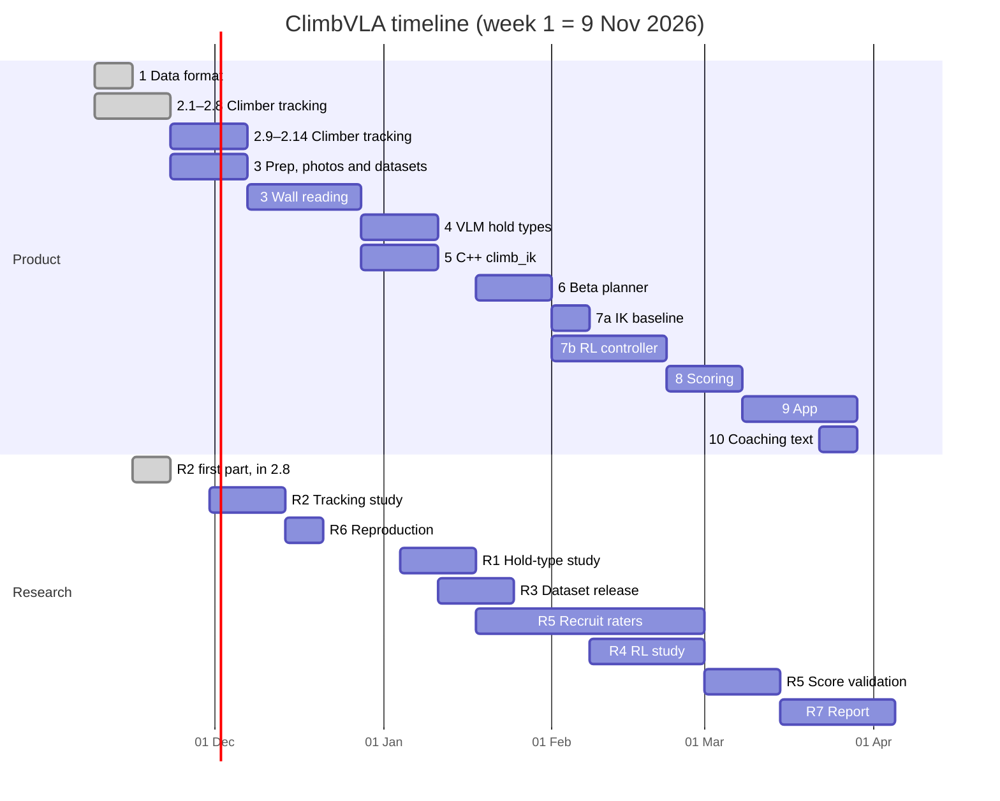

# ClimbVLA — Project Plan

ClimbVLA compares how a person climbs a boulder problem with how a simulated
reference climber would climb the same route, and scores the difference
(the **Beta Score**).

This plan replaces the original specification. Technology versions were chosen
from memory, not a fresh search — check current versions at install time.

## 1. Design decisions

| Decision | What it means | Why |
|---|---|---|
| Contacts in image pixels | Step 2 finds contacts and moves in the image itself: holds are clicked (later detected) per video, and distances are measured relative to the climber's body. Contacts and moves stay in pixels (`PixelContact`) until 2.14 converts them to meters | Real gym videos are filmed from below and to the side, often on multi-panel overhangs, so no single pixels-per-meter scale fits. Decided on 2026-11-12, on the first real video |
| Wall-plane 2D, later | Holds, pose and simulation share one 2D frame in meters for metrics in meters, comparing two videos, and steps 6–8. Pixels are converted per wall panel, from clicked reference points | Depth from one camera is unreliable; one mapping per panel handles walls made of several panels |
| Planner + single-move controller | A search planner picks the limb-to-hold sequence; a learned policy executes one move at a time | One policy learning whole routes from torques is a research problem; single moves are learnable |
| Holds as attachment points | A hand or foot attaches when it is within a small radius of a hold | Avoids simulating finger friction |
| Move-by-move comparison | Both climbs are cut into moves at contact changes, then compared inside each move | The user and the reference never move at the same speed |
| Static camera, any angle | One climber, phone held still for the whole climb, whole route in frame | Holds clicked once stay valid on every frame |

Two parts are kept deliberately as goals in themselves:

- **C++ module** (`climb_ik`, pybind11) — reachability and inverse kinematics
  for the planner.
- **VLM fine-tuning** — hold-type classification from crops, with LoRA.

## 2. Pipeline

```
video ──► first frame ──► hold detector ──► color grouping ──► route holds
  │                                              │
  │                                  VLM (fine-tuned): hold types
  │                                              │
  └──► pose model ──► skeleton (pixels) ──► contacts ──► user moves + metrics
                                                 │
                         route holds ──► beta planner (uses climb_ik)
                                                 │
                                     reference sequence of moves
                                                 │
                              IK baseline ──► PPO single-move policy (MuJoCo)
                                                 │
                                        reference trajectory
                                                 │
                    user moves + reference ──► scorer ──► Beta Score
                                                 │
                                   VLM: coaching text ──► web app
```

## 3. Steps

### Step 1 — Shared data format
Pydantic models for `Hold`, `Route`, `PoseFrame`, `ContactEvent`, `Move`,
`Trajectory` and `Audit`. Every stage reads and writes these, as JSON on disk.

*Done when:* a hand-written example route and trajectory validate and round-trip.

### Step 2 — Climber tracking
Works in image pixels (see §1). Sub-steps, ✅ = done:

- ✅ **2.1 Read a video:** frames with the file's own timestamps.
- ✅ **2.2 Pose on one frame:** RT-DETR finds the person box, a keypoint model
  the 17 keypoints (ViTPose-B at first, RTMPose-x since 2.8).
- ✅ **2.3 Pose on the whole video, saved once** (`PoseTrack`, `.npz`). The
  climber is followed by box overlap with the previous frame.
- ✅ **2.4 Overlay video** to check the pose by eye.
- ✅ **2.5 Checkpoint:** the pose looked good enough by eye on the first real
  video. Measured in 2.8, ViTPose-B was not, on the hidden right wrist.
- ✅ **2.6 Hold-clicking tool:** `VideoRoute`, holds in pixels for one video.
  Small addition still to do: a median "empty wall" image to click on.
- ✅ **2.7 Cleaning the pose** (`CleanPose`): hide low-confidence joints, fix
  left/right swaps, drop points seen for only 1–2 frames, fill gaps up to
  0.3 s unless the point would have had to move faster than 3 torso lengths
  per second, smooth (Savitzky–Golay). Known limit: hidden wrists and ankles
  are sometimes placed on the wrong body part with confidence 0.5–0.65, at
  positions a bone-length check can't rule out.
- ✅ **2.8 Pose model check** (the pose part of R2, done early because of
  2.7's limit): wrists and ankles clicked by hand on 46 frames of the first
  real video (184 points), and three keypoint models compared on the same
  person boxes. Within 0.2 torso lengths: ViTPose-B 87% (right wrist 57%),
  ViTPose+ Huge 94% (80%), RTMPose-x 95% (80%). At threshold 0.5 RTMPose-x
  kept 0 wrong points (Huge 4, B 6) and dropped 6 right ones; 0.7 drops 26.
  **Chosen: RTMPose-x, threshold 0.5** (0.07 s per frame on the CPU). Limits:
  one video, one climber, one labeler; no point was labeled "hidden".
- ✅ **2.9 Contact detection, in pixels** (`contacts.py`, saved as
  `VideoContacts` of `PixelContact`): close + nearly still for 0.2 s, with
  hysteresis (hand lands within 0.10 torso lengths of a hold's circle, leaves
  beyond 0.25; feet 0.35 / 0.50, since the ankle is not the toes). Targets:
  route holds, the ground (feet as low as at the start), the wall (still feet
  off the route's holds: smears and other routes' holds). Hidden parts keep
  their contact. Weak evidence: where the wrist or ankle is only seen with low
  confidence, its half-second median can still land it on a hold (Robert's
  right hand on h5, confidence 0.2–0.46). `overlay --contacts` to check.
  Known limits: "wall" can't tell a smear from a foot hanging still; seen from
  the side, a limb in front of a hold may not touch it; thresholds fitted on
  one video.
- ✅ **2.10 Moves from contacts** (`moves.py`, saved in `VideoContacts` as
  `PixelMove`s and `PixelRegrip`s next to the contacts): every gap between two
  contacts of one body part is a move (different target) or a regrip (back on
  the same hold, the ground, or a wall spot within 0.5 torso lengths). Moves
  may last 0 s (sliding off a hold onto the wall); dynos are overlapping moves.
  They become `Move`s and `ContactEvent`s in meters only in 2.14 (decided
  2026-11-20). First real video: 14 moves, 1 regrip. Known limit: three moves
  of 0.1–0.3 s cover only 0.4–0.5 torso lengths (LH h8 → h4, RF h3 ↔ wall),
  likely a hand or foot sitting between two targets rather than a real move;
  2.13 will tell.
- ✅ **2.11 Metrics** (`metrics.py`, saved as `VideoMetrics` in
  `<video>_metrics.json`, one `PixelMoveMetrics` per move; `overlay --metrics`
  draws the center of mass and lists the elbow angles). Each move is measured
  over its *phase*: from the last contact change of any body part until it lands.
  - angle-based, no scale needed: **straight-arm ratio** (share of on-hold
    frames with the elbow open at least 150°) and **lock-off time** (a hand on
    a hold with the elbow under 120° while the other hand is off the holds).
    An elbow angle is left unknown when a segment looks shorter than 0.6 of
    its usual length (pointing at the camera);
  - distance-based, in body units within one video: center-of-mass path
    (Winter's segment masses; a hidden limb's mass at its last known joint) and
    its length relative to the direct path, **smoothness** as SPARC (spectral
    arc length of the center-of-mass speed) instead of jerk, which changed with
    the filter settings more than with the climbing (decided 2026-11-24), and
    hesitation (still center of mass before the move leaves).
  - First real video: straight-arm ratio 68%, lock-off 0 s, hesitation 6.9 s,
    median SPARC -2.3 (one smooth push is about -1.4).
  - **Balance margin moved to 2.14** (decided 2026-11-24): it was built here as
    the sideways distance of the center of mass inside the span of the current
    supports, then removed after watching the overlay. In pixels "sideways" can
    only be the image's x: on the first real video that is mostly the distance
    from the wall (start wall filmed from the side) or a mix of along and away
    from the roof (overhang filmed from below), and the value jumped by one
    torso length when a foot left the ground, with the body still.
- **2.12 Command-line tool:** video + clicked holds → moves, metrics, overlay.
- **2.13 Accuracy:** precision and recall of contacts against hand-labeled
  contacts, including false contacts from the side view. Also decides whether
  feet need toe keypoints: if foot contacts are clearly worse than hand
  contacts, switch to a whole-body pose model (COCO-WholeBody: big toe, small
  toe and heel points), which means rerunning the pose and going beyond 17
  keypoints (decided 2026-11-20).
- **2.14 Pixels → wall-plane meters,** per wall panel, from clicked reference
  points (possibly the holds already clicked). Needed for metrics in meters,
  for comparing two videos of the same route, and for steps 6–8. Adds the
  **balance margin** (from 2.11), in wall coordinates, trusted only on roughly
  frontal videos: the center of mass is off the wall plane, so a per-panel
  mapping places it wrongly when the camera films from the side.

*Done when:* a real video, with hand-clicked holds, produces a move list and
metrics that look right on the overlay.

### Step 3 — Wall reading
- Fine-tune a segmentation detector on public climbing-hold datasets plus a
  small set of own photos.
- Group detected holds into routes by color (clustering on mask pixels in Lab
  color space).
- The user confirms or corrects the route in the UI — detection will not be
  perfect, and one wrong hold breaks everything downstream.

*Done when:* hold detection reaches a usable mAP on held-out walls and the
route for a test video needs at most a couple of manual fixes.

### Step 4 — VLM fine-tuning: hold types
- **Task:** given a crop of one hold, output JSON
  `{"type": "crimp|sloper|jug|pinch|volume|foothold", "confidence": ...}`.
- **Data:** crops come from the step 3 detector, so 100–200 wall photos yield
  thousands of crops. Label a few hundred to start.
- **Method:** LoRA on a small Qwen3-VL. Locally with MLX on the Mac, or with
  `peft` + 4-bit quantization on a cloud GPU.
- **Baselines, so the fine-tune means something:** the same VLM zero-shot, and
  a DINOv2 linear probe.
- **Report:** accuracy and macro-F1 on held-out walls, tracked in W&B.

*Done when:* the fine-tuned model beats zero-shot clearly, and the comparison
with the linear probe is written down honestly whichever way it goes.

### Step 5 — C++ kinematics module (`climb_ik`)
- Analytic two-link inverse kinematics for arms and legs, with joint limits.
- Reachability: given the attached limbs, can limb *L* reach hold *H*? Returns
  the feasible hip/shoulder region or "unreachable".
- Batched queries, since the planner asks thousands per route.
- Built with pybind11, CMake and scikit-build-core; Eigen for the math.
- Tested against a NumPy reference implementation, with a benchmark.

*Done when:* results match the NumPy reference and the speed-up is measured.

### Step 6 — Beta planner
- State: which hold each limb is on. Action: move one limb to a new hold.
- Search (A*) with feasibility from `climb_ik` and a cost built from reach
  distance, balance margin and hold type (from step 4).
- Output: the reference sequence of moves.
- First feedback product: compare the user's sequence with the planner's.

*Done when:* the planner produces a sensible sequence on several real routes.

### Step 7 — Reference motion
- **7a. Kinematic baseline.** Interpolate between planned stances with inverse
  kinematics. Guaranteed to exist; good enough to build the scorer and the UI.
- **7b. Learned controller.** MuJoCo planar climber (torso plus four two-segment
  limbs: 9 bodies, 8 actuated joints). PPO trained on *single moves* with
  randomized hold positions, wall tilt and limb lengths. Reward: progress
  toward the target hold, minus effort, minus center-of-mass drift, bonus on
  reach, penalty on fall. Chain the policy along the planned sequence.

*Done when:* 7a works on every planned route; 7b completes most single moves in
evaluation and can be chained over at least a short route.

### Step 8 — Scoring
- Match user moves to reference moves by hold and limb.
- Time-warp (DTW) inside each matched move, then compare joint angles and
  center-of-mass path.
- Beta Score = weighted mix of sequence agreement, metric gaps and motion
  deviation, with per-move breakdown.

*Done when:* a deliberately sloppy climb scores visibly worse than a clean one
on the same route.

### Step 9 — App
- Backend: upload endpoint, background job, progress over WebSocket, results as
  JSON plus the overlay data.
- Frontend: video with skeleton overlay next to the simulated climber, one
  shared scrubber, per-move timeline and metric charts, route correction UI.

### Step 10 — Coaching text
The VLM turns the numeric audit into a short written review per move.

## 4. Research track

The steps above build the product. The research track turns parts of it into
careful experiments, released artifacts and a written report, aimed at
research engineer roles. Each item extends a step above; none adds a new
pipeline stage.

Rules for the whole track:

- Fix held-out splits **before** running experiments, and split by gym or
  wall, never by frame or crop.
- At least 3 seeds per configuration; report mean and spread.
- Every number in a report traces back to a W&B run and a config in the repo.
- Report negative results and failed runs, not only the best one.

### R1 — Hold-type study (extends step 4)
- Compare zero-shot VLM, DINOv2 linear probe, and LoRA at several ranks
  (e.g. 4, 16, 64).
- Data-scaling curve: 50, 100, 200, 500 labeled crops.
- Per-class results and a confusion matrix; note which types humans also
  disagree on.

*Done when:* a results table and a scaling plot with error bars exist, measured
on unseen walls.

### R2 — Tracking ablations (extends step 2)
- Pose model: ViTPose++ vs RTMPose on climbing footage, scored (PCK) against a
  small hand-annotated keypoint set. A first version on one video is step 2.8
  (ViTPose-B, ViTPose+ Huge, RTMPose-x; RTMPose-x chosen); R2 extends it to
  more videos and climbers.
- Smoothing: none vs One-Euro vs Savitzky–Golay, measured by its effect on
  contact detection.
- Contact detection precision and recall against hand-labeled contacts.

*Done when:* the chosen pose model, filter and contact thresholds are each
justified by a measured comparison.

### R3 — Dataset release
- Hold crops with type labels, and annotated videos with contacts and moves.
- Fixed train/val/test splits, a dataset card (sources, licenses, labeling
  protocol, known biases) and the baseline tables from R1 and R2.
- Only images whose source licenses allow redistribution; no identifiable
  people without their consent.

*Done when:* published on Hugging Face and loadable with `datasets`.

### R4 — RL study (extends step 7b)
- Log every training run, including the ones that fail.
- Ablate reward terms, curriculum and domain-randomization ranges.
- Success rate per move type, and generalization to unseen hold layouts and
  limb lengths.

*Done when:* a write-up explains what made the single-move policy converge,
with training curves over several seeds.

### R5 — Beta Score validation (extends step 8)
- A few experienced climbers or coaches rate or rank a set of climbs on the
  same routes, without seeing the Beta Score.
- Measure rank correlation (Spearman or Kendall) between the Beta Score and
  the human ratings, with a confidence interval.
- Use agreement between the human raters as the ceiling, and ablate the score's
  weights against it.

*Done when:* the correlation is reported next to inter-rater agreement.

### R6 — Paper reproduction
- Reproduce one published result used by the project, e.g. ViTPose accuracy on
  COCO val, or a standard Stable-Baselines3 PPO MuJoCo benchmark.

*Done when:* the reproduced numbers match the published ones within their
reported tolerance, or the gap is explained.

### R7 — Technical report
- 6–10 pages: method, experiments R1–R5, limitations.
- Posted on arXiv; submitted to a relevant workshop (e.g. a computer vision in
  sports workshop at CVPR or ICCV).

*Done when:* submitted.

Alongside the track: contribute fixes or examples upstream to the libraries
the project uses (`transformers`, `peft`, Stable-Baselines3, MuJoCo, `rtmlib`)
when the project runs into their gaps.

## 5. Technology

| Area | Choice | Notes |
|---|---|---|
| Language / packaging | Python 3.12, `uv` | |
| Data contracts | Pydantic v2 | |
| Pose | RT-DETR person boxes, then RTMPose-x (ONNX, `onnxruntime`) | Chosen in 2.8 against hand labels; ViTPose-B / ViTPose+ Huge kept for comparison. Not `rtmlib`: it needs `opencv-contrib-python`, which clashes with `opencv-python` |
| Hold detection | RF-DETR segmentation | Apache 2.0. YOLO11-seg is an alternative but AGPL-licensed |
| VLM | Qwen3-VL, small size, LoRA | MLX locally, or `peft` on a cloud GPU |
| Classifier baseline | DINOv2 linear probe | |
| Physics | MuJoCo | |
| RL | Stable-Baselines3 PPO, Gymnasium | Vectorized CPU environments |
| C++ | C++17, Eigen, pybind11, scikit-build-core | |
| Experiment tracking | Weights & Biases | |
| Backend | FastAPI, in-process job runner, local disk | Add a queue only if needed |
| Frontend | React, TypeScript, Vite, react-three-fiber, Tailwind, Recharts | Browser replays recorded trajectories; no physics in the browser |
| Packaging | Docker Compose | Last, once the pipeline is stable |

## 6. Order and timing

21 weeks in total, one person full time. Week 1 starts Monday 9 November 2026;
the report is submitted in week 21 (29 March – 4 April 2027). Holidays are not
included: the Christmas weeks (7–8) will likely push everything back a week or
two.

| Block | Steps | Research track | Weeks | Dates | Result |
|---|---|---|---|---|---|
| A | 1–3 | R2, R6 | 1–7 | 9 Nov – 27 Dec | Video in, moves and metrics out, holds detected |
| B | 4–5 | R1, R3 | 8–11 | 28 Dec – 24 Jan | Hold-type study; dataset released; tested C++ module |
| C | 6–8 | R4, R5 | 11–18 | 18 Jan – 14 Mar | Planner, reference motion, validated Beta Score |
| D | 9–10 | R7 | 18–21 | 8 Mar – 4 Apr | Web app, coaching text, technical report |



| Weeks | Dates | Product | Research |
|---|---|---|---|
| 1–2 | 9 – 22 Nov | 1 ✅; 2.1–2.8 ✅ | R2 first part (2.8) ✅ |
| 3–4 | 23 Nov – 6 Dec | 2.9–2.14; start collecting wall photos and hold datasets for 3 | R2 from week 4 |
| 5–7 | 7 – 27 Dec | 3 | R2 until week 5; R6 in week 6, while the detector trains |
| 8–10 | 28 Dec – 17 Jan | 4 and 5 in parallel (weeks 8–9) | R1 (weeks 9–10); R3 from week 10 |
| 11–12 | 18 – 31 Jan | 6 | R3 until week 11; start recruiting R5 raters |
| 13–15 | 1 – 21 Feb | 7a (week 13), 7b | R4 from week 14 |
| 16–17 | 22 Feb – 7 Mar | 8 | R4 until week 16; R5 validation from week 17 |
| 18–20 | 8 – 28 Mar | 9; 10 in week 20 | R5 until week 18; R7 from week 19 |
| 21 | 29 Mar – 4 Apr | — | R7: submit |

Notes:

- Step 5 runs alongside step 4 because the VLM trains on a GPU while the C++
  module is written. Steps 4 and 5 are independent of step 2, so they can still
  move earlier.
- R6 can move to any week; week 6 is chosen because it is mostly waiting for
  training runs.
- Raters for R5 are recruited from week 11 because finding climbers or coaches
  takes time (see §7).
- The first estimate (2026-11-11) was 13–19 weeks. It grew to 21 mainly because
  step 2 grew from one step to 14 sub-steps (block A: 7 weeks instead of 3–4).
  Blocks B to D keep roughly their first estimate.

## 7. Main risks

- **Pose quality on climbing footage.** Back-facing, stretched, self-occluded
  poses are hard. Check on real videos in step 2 before building on top.
- **Walls made of several panels.** Steps 6–7 assume one flat wall plane with
  one tilt angle; overhangs like the first test video's have several panels.
  Decide before step 6 whether the planner and the simulation handle panels or
  use a flattened approximation.
- **Single-move policy not converging.** Step 7a exists so the rest of the
  project never waits on RL.
- **"Optimal" is a strong word.** The reference is the best sequence under the
  planner's cost model, not ground truth. The UI should say "reference".
- **Body differences.** The simulated climber must be scaled to the user's
  limb lengths, or reach-limited moves will be judged unfairly.
- **Research track crowding out the product.** Ablations and seeds multiply
  compute and time. Keep each R item scoped to what its "Done when" asks.
- **Few human raters for R5.** Line up climbers or coaches early; a small but
  consistent panel beats a large noisy one.
